  

# 🛒 Awesome Digital Storefront & E-Commerce 🛍️

  
  
  
  
  
  

**Curated Catalog of SaaS Platforms, Self-Hosted Storefronts, Headless Commerce APIs &amp; Open-Source Alternatives**  
*Comprehensive developer guide to e-commerce architecture, zero-GMV platforms, online carts, and transparent total-cost-of-ownership (TCO).*

---

## 📖 Overview & Ecosystem Summary

Welcome to the **Awesome Digital Storefront & E-Commerce** repository — a deeply curated directory of top cloud SaaS platforms, modular headless commerce backends, and self-hosted open-source online store systems.

Whether you are launching a direct-to-consumer (D2C) brand, building a composable multi-vendor marketplace, migrating away from proprietary transaction penalties, or architecting a headless microservice stack, this guide breaks down technical features, real-world pricing structures, starting tier fees, and GitHub community traction.

---

## 📑 Table of Contents
- [🌐 Sector Overview & Market Dynamics](#-sector-overview--market-dynamics)
- [☁️ SaaS & Hosted Platforms](#️-saas--hosted-platforms)
- [💻 Open-Source GitHub Projects](#-open-source-github-projects)
- [📈 Star History](#-star-history)
- [🤝 How to Contribute](#-how-to-contribute)
- [💖 Support & Sponsorship](#-support--sponsorship)
- [⚖️ Disclaimer & Cost Analysis](#️-disclaimer--cost-analysis)

---

## 🌐 Sector Overview & Market Dynamics

The global digital commerce platform and e-commerce software market is valued at **$7B–$11B (2025–2026)** and is projected to expand past **$15B–$30B by the early 2030s** at a compound annual growth rate (CAGR) of 10%–16%. 

The industry exhibits a **moderately concentrated, winner-take-most oligopoly** at the core SaaS/enterprise infrastructure tier (dominated by platforms like Shopify, WooCommerce/Automattic, and Adobe Commerce/Salesforce), but remains **highly fragmented** across long-tail merchant niches, regional payment ecosystems, and developer-centric open-source headless commerce alternatives.

---

## ☁️ SaaS & Hosted Platforms

> [!NOTE]
> Platforms are sorted in **descending order by company size** (market capitalization, enterprise valuation, or annual revenue).

| 🏷️ Product | 🏢 Size (Revenue / Valuation) | 📝 Description | 💵 Starting Tier Pricing | 🎁 Free Tier / Trial Plan Limits |
|:---|:---|:---|:---|:---|
| **[Shopify](https://www.shopify.com/)** | ~$11.6B revenue / ~$195B–$270B market cap | Leading cloud commerce platform with 2M+ active merchants. Payment processing: 2.9% + 30¢ (Basic), 2.7% + 30¢ (Grow), 2.5% + 30¢ (Advanced). Third-party payment gateways incur an additional 0.6%–2% platform transaction fee. | **$29/month** (Basic plan, billed annually at $29/mo or $39/mo monthly) | **3-day free trial** without credit card; checkout and live customer order processing remain locked until a paid plan is selected (promotional $1/mo extension for 3 months often offered) |
| **[Zoho Commerce](https://www.zoho.com/commerce/)** | ~$1.4B revenue / ~$10B–$12.5B estimated valuation | E-commerce platform within the bootstrapped Zoho business suite. Features zero platform transaction fees, free cloud hosting, unmetered bandwidth, and custom domain setup. | **$15/month** (Standard plan, billed annually at $15/mo or $22/mo monthly) | **14-day free trial** with full feature access and no credit card required; store pauses automatically upon expiration unless upgraded |
| **[Wix eCommerce](https://www.wix.com/)** | ~$1.99B revenue / ~$3.1B–$3.8B market cap | Visual drag-and-drop website builder with integrated e-commerce infrastructure. Wix Payments processing: 2.9% + 30¢ (standard US cards). | **$29/month** (Core plan, billed annually) | **Forever Free plan** available (limited to 500MB storage, 1GB bandwidth, Wix branding/subdomain), but **$0 online payment checkout enabled** (14-day trial period on paid plans) |
| **[Ecwid](https://www.ecwid.com/)** | ~$20M revenue / $500M acquisition valuation (Lightspeed) | Embeddable shopping cart widget and storefront builder that adds online checkout to existing CMSs, WordPress, or social channels. | **$5/month** (Starter plan) / **$29/month** (Venture plan billed annually, or $35/mo monthly) | **Forever Free / Starter tier** strictly capped at **up to 10 products**, Instant Site builder, and basic payment gateway support with no expiration |
| **[BigCommerce](https://www.bigcommerce.com/)** | ~$342M revenue / ~$200M market cap | Open-SaaS commerce platform focused on mid-market, headless setups, and high-volume B2B merchants. Imposes an Open Payment Provider fee of 0.6%–2.0% on non-embedded payment gateways. | **$29/month** (Core plan, billed annually at $29/mo, or $39/mo monthly) | **15-day free trial** with full platform capabilities, sandbox test data, and no credit card required; store is locked upon expiration unless upgraded |

---

## 💻 Open-Source GitHub Projects

> [!TIP]
> The table below lists top open-source storefronts, self-hosted shopping carts, and headless commerce engines, **sorted in descending order by GitHub_Stars**. Every badge links directly to the project's stargazers page.

| 🛠️ Project | ⭐ GitHub_Stars | 💡 Tech Stack | 📋 Description & Capabilities |
|:---|:---|:---|:---|
| **[Medusa](https://github.com/medusajs/medusa)** |  | Node.js / TypeScript | **The leading open-source headless commerce framework for JavaScript & TypeScript.** Modular architecture, REST APIs, zero GMV fees, customizable checkout flows, multi-currency routing, and plug-and-play integrations with Next.js and Remix. |
| **[Bagisto](https://github.com/bagisto/bagisto)** |  | PHP / Laravel | **Laravel-based headless e-commerce ecosystem.** Ships with a built-in admin dashboard, GraphQL API, multi-channel marketplace functionality, progressive web app (PWA) storefronts, and full internationalization. |
| **[Saleor](https://github.com/saleor/saleor)** |  | Python / Django / GraphQL | **Enterprise-grade open-source headless commerce platform powered by GraphQL and Django.** Built for ultra-fast, multi-tenant global commerce with composable microservices and webhook-driven event architecture. |
| **[Spree Commerce](https://github.com/spree/spree)** |  | Ruby on Rails | **Complete, modular open-source e-commerce solution built with Ruby on Rails.** Offers headless API-first commerce, out-of-the-box frontend storefronts, scalable multi-store management, and hundreds of battle-tested extensions. |
| **[Reaction Commerce](https://github.com/reactioncommerce/reaction)** |  | Node.js / GraphQL / MongoDB | **API-first, real-time headless commerce engine.** Optimized for enterprise retail environments handling millions of catalog items and high-throughput real-time order processing. |
| **[Adobe Commerce (Magento Open Source)](https://github.com/magento/magento2)** |  | PHP / MySQL | **The powerhouse self-hosted open-source engine of Magento.** Provides unmatched enterprise customizability, complex B2B catalogs, and vast plugin ecosystems, though requiring dedicated engineering teams and infrastructure. |
| **[WooCommerce](https://github.com/woocommerce/woocommerce)** |  | PHP / WordPress | **The world's most widely deployed open-source e-commerce platform.** Free WordPress core plugin with zero platform fees, infinite theme customizability, REST APIs, and an ecosystem of thousands of extensions. |
| **[nopCommerce](https://github.com/nopSolutions/nopCommerce)** |  | ASP.NET Core / C# | **Leading open-source e-commerce shopping cart based on Microsoft ASP.NET Core.** Features enterprise multi-store, multi-vendor marketplace tools, high performance, and robust security out of the box. |
| **[PrestaShop](https://github.com/PrestaShop/PrestaShop)** |  | PHP / Symfony | **User-friendly, mature open-source e-commerce platform powering 250,000+ stores globally.** Lightweight to deploy on shared or cloud VPS hosting, with an extensive community theme and add-on marketplace. |
| **[Vendure](https://github.com/vendure-ecommerce/vendure)** |  | TypeScript / NestJS / GraphQL | **Modern headless GraphQL commerce framework built on NestJS.** Designed around developer happiness, structured plugin systems, intuitive admin UI, and microservice modularity. |
| **[Sylius](https://github.com/Sylius/Sylius)** |  | PHP / Symfony | **Modern PHP commerce framework based on Symfony components.** Follows clean architecture, domain-driven design (DDD), and test-driven development (TDD) for complex B2C and B2B requirements. |
| **[OpenCart](https://github.com/opencart/opencart)** |  | PHP / MySQL | **Classic, easy-to-use open-source shopping cart management solution.** Well-suited for small to medium merchants seeking simple installation, built-in order management, and low server resource footprints. |
| **[Aimeos](https://github.com/Aimeos/aimeos)** |  | PHP / Laravel / Symfony | **Ultra-fast, scalable open-source e-commerce framework.** Capable of sub-15ms response times, 1B+ product catalogs, multi-tenant marketplace capabilities, and seamless Laravel/Symfony embedding. |
| **[Solidus](https://github.com/solidusio/solidus)** |  | Ruby on Rails | **Community-driven, highly customizable e-commerce framework for Ruby on Rails.** Built for high-volume retailers requiring stable, reliable, and testable commerce cores with zero vendor lock-in. |
| **[Shopware](https://github.com/shopware/shopware)** |  | PHP / Symfony / Vue.js | **Leading European open-source headless commerce platform.** Highly regarded for visual shopping experiences ("Experience World"), API-first architecture, and advanced B2B commerce modules. |

---

## 📈 Star History

---

## 🤝 How to Contribute

Contributions, suggestions, and corrections are always welcome! 

1. **Fork** the repository: `https://github.com/ishandutta2007/Awesome-Digital-Storefront-E-Commerce`
2. **Create a branch**: `git checkout -b feature/new-commerce-tool`
3. **Add/Update entries**: Ensure factual descriptions, official documentation URLs, starting tier pricing, and clear open-source/SaaS classification.
4. **Submit a Pull Request**: Include a short explanation of the added or revised tool.

---

## 💖 Support & Sponsorship

If you find this curated directory useful for your projects, architecture research, or client work, please consider supporting the project:

- ⭐ **Star this repository** to help others discover it on GitHub!
- 🍴 **Fork it** to keep a reference copy in your profile.
- 📢 **Share it** on Twitter/X, LinkedIn, Reddit, and developer communities.
- ☕ **Buy me a coffee / Sponsor**: Support ongoing maintenance, research, and open-source updates via the [GitHub Sponsors Dashboard](https://github.com/sponsors/ishandutta2007).

---

## ⚖️ Disclaimer & Cost Analysis

- **Independent Community Resource**: This repository is a community-maintained index for informational and architectural evaluation purposes. It is not affiliated with or sponsored by any mentioned vendors.
- **Compliance & Security**: All digital storefront solutions handling payment card data, user authentication, and customer Personally Identifiable Information (PII) must comply with PCI-DSS specifications, tokenization standards, GDPR/CCPA regulations, and least-privilege credential security.
- **Total Cost of Ownership (TCO) Reality Check**:
  - Open-source platforms like **WooCommerce**, **Medusa**, **Saleor**, and **PrestaShop** eliminate platform revenue splits and GMV commissions, but require hosting costs ($20–$500+/mo), developer maintenance, backups, and payment gateway fees (~2.5–2.9% + 30¢).
  - Enterprise open-source deployments like **Magento (Adobe Commerce)** require substantial continuous engineering investment, often scaling to five-year total operating costs exceeding **$350,000+**.
  - SaaS platforms like **Shopify** and **BigCommerce** provide managed reliability and security patching, but charge ongoing monthly subscription fees plus **third-party payment gateway transaction fees (0.6%–2.0%)** if not using their proprietary native gateways. Always calculate total transaction cost across your projected gross merchandise volume prior to selection.

Made with ❤️ for merchants, software engineers, and digital commerce architects worldwide.

